# DBC · Database Client

企业级 Web 数据库客户端：统一登录与组织权限，治理数据资产，在工作空间内受控执行 SQL，并留存审计。

浏览器**不直连**目标库；目标库访问只经执行面 `dbc-sqlwork`。管控面 `dbc-manage` 负责资产 / 授权 / 策略，不持目标库长连接。

[架构设计](doc/设计/架构/01-架构设计.md) · [需求设计](doc/设计/需求/01-需求设计.md) · [本地启动](doc/运维/01-本地启动说明.md) · [Docker 部署](doc/运维/02-Docker桌面部署手册.md) · [文档索引](doc/README.md)

---

## 功能概览

| 能力 | 说明 |
| --- | --- |
| 用户中心 | 登录 / JWT、用户 / 部门 / 角色、功能权限、应用 mTLS 与代签 |
| 资产管理 | 实例与连接登记、凭证加密存储、部门数据范围 |
| 权限管控 | 工作空间（公司 / 个人）、成员与连接授权、全局管控策略 |
| SQL 工作台 | 多会话编辑、按方言批执行、元数据浏览、事务会话 |
| 智能问数 | 自然语言生成工作流、人工确认与执行、知识库与库表关系、批量测评 |
| 审计 | SQL 执行审计 + 业务操作审计（Elasticsearch） |
| 系统管理 | 应用登记等平台运维能力 |

默认账号：`admin` / `admin`（首次部署后请立即修改）。

---

## 使用说明与样例

以下按“用户与资产准备 → 空间授权 → SQL 查询 → 智能问数与测评”介绍操作入口。截图中的 `pg` 连接、`lyj` 工作空间、`company` 数据及测评结果来自已有环境，仅作为使用示例；地址、对象范围与账号需按实际环境配置，菜单与按钮以当前用户权限为准。

### 1. 管理用户与组织权限

进入 **用户中心 → 用户管理**，按账号查询用户，通过“新增用户”“编辑”“重置密码”维护账号。部门、角色与功能权限分别在左侧对应菜单中管理；功能权限决定用户可访问的管理入口，数据操作范围还需通过工作空间授权配置。

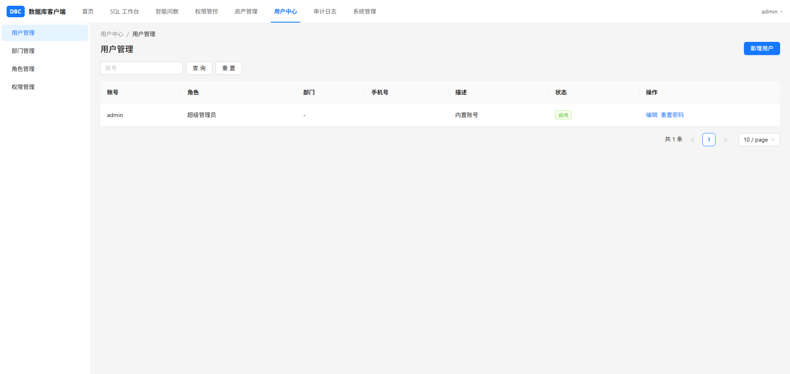

### 2. 查看服务应用状态

进入 **系统管理 → 应用管理**，查看用户中心、资产管理、SQL 工作台、审计与智能问数等应用的登记及启用状态。该页面还提供公钥查看、证书重签、签名自测和本服务签名密钥轮换入口，供服务间认证与签名运维使用。

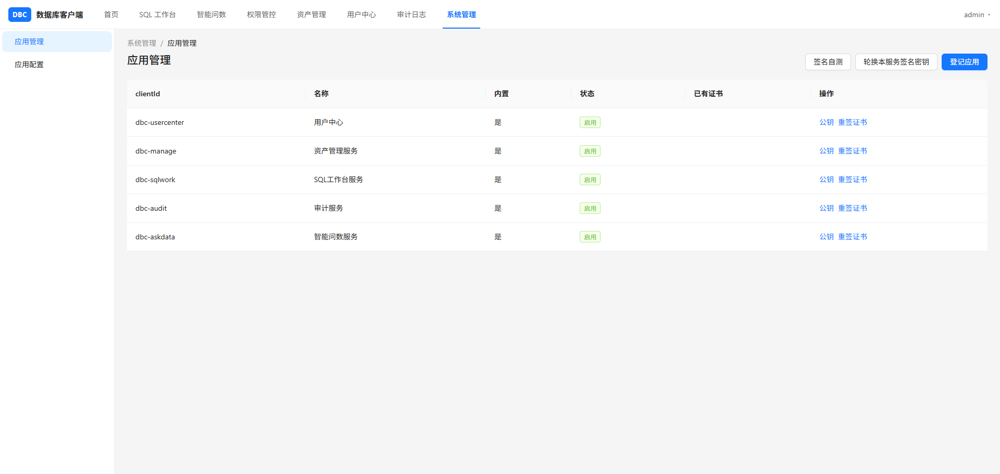

### 3. 登记数据库实例与连接

进入 **资产管理 → 实例管理**，新增数据库实例，配置类型、地址与所属部门，并按需管理 JDBC 驱动。随后进入 **连接管理** 登记访问连接与凭证，供工作空间挂载使用。截图以 PostgreSQL 实例 `pg` 为例；实例登记由管控面负责，实际 SQL 经执行面访问目标库。

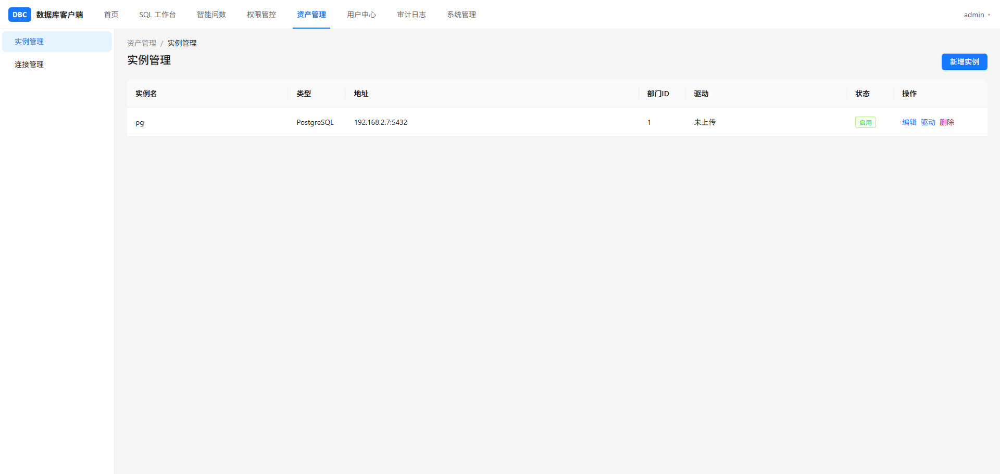

### 4. 配置全局管控策略

进入 **权限管控 → 全局管控**，新增策略并选择管控指令、作用空间和处理方式。图中的“全局禁止写”对 `INSERT`、`UPDATE`、`DELETE` 使用阻断策略。

全局策略叠加在工作空间授权之上：阻断优先于二次鉴权，二次鉴权优先于告警。因此，即使空间中授予“任意 SQL”，仍会受到全局阻断策略约束。

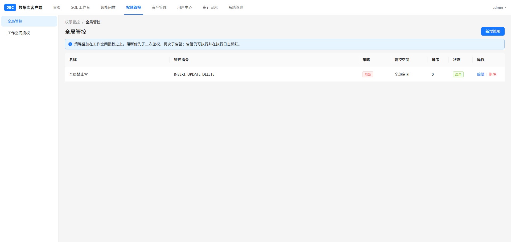

### 5. 创建工作空间并分配资产与成员权限

进入 **权限管控 → 工作空间授权**。具备相应操作权限的用户可新建公司空间，创建者成为空间所有者；点击已有空间的“进入”打开详情。

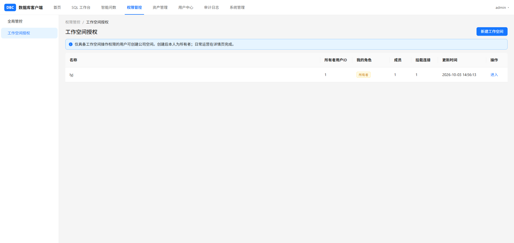

在 **资产授权** 页新增连接授权，限定数据库、对象范围与 SQL 操作权限；再到 **成员授权** 页分配成员权限。成员权限只能在空间已有资产授权范围内分配。图中示例将 `pg` 连接的 `postgres` 数据库挂载到 `lyj` 空间。

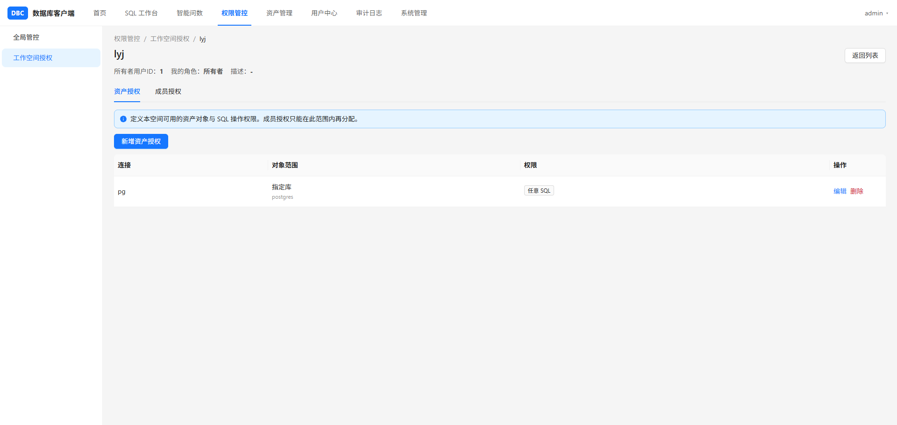

### 6. 进入 SQL 工作台执行查询

打开 **SQL 工作台**，先在左侧选择工作空间，查看可访问的连接、对象范围与操作权限，再点击“进入工作台”。

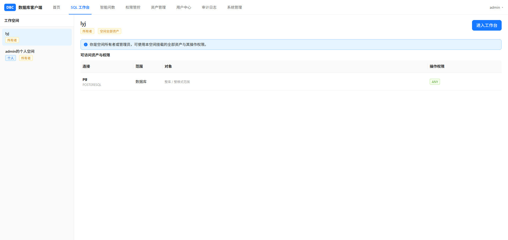

进入编辑器后，选择连接、数据库与模式，在左侧浏览元数据树，在编辑区输入 SQL 并点击“执行”。下方可切换执行日志和结果；工具栏提供自动提交开关及 `BEGIN`、提交、回滚等事务操作。

下图展示查询 `askdata.ask_app_config` 的结果。首次验证连接时，也可执行简单查询：

```sql
SELECT current_database(), current_schema();
```

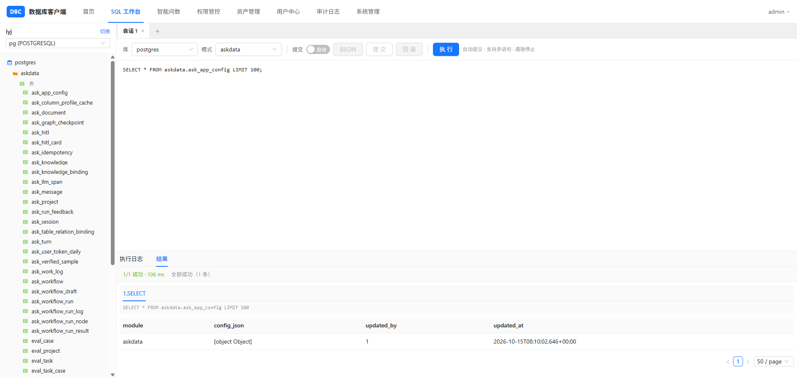

### 7. 选择智能问数空间

进入 **智能问数 → 问数空间**，先在右上角选择工作空间，再按用途进入：

- **工作空间**：日常用自然语言生成工作流，人工确认、保存后执行。
- **测评空间**：引用模板或自定义用例，批量运行并对比结果。

智能问数需预先配置可用模型服务，配置方式见 [智能问数服务说明](dbc-askdata/README.md)。

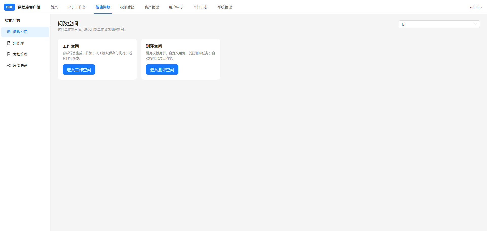

### 8. 用自然语言生成查询工作流

进入问数工作空间，新建或选择工程，配置来源与工作库 / 模式。在对话中描述对象、筛选条件和需要返回的字段，例如：

> 办公用品里用品编码是 SUP001 的，把用品名称、状态查出来。

模型生成工作流草稿后，先检查 SQL 与业务口径，按提示保存，再通过工作流执行。截图展示的是草稿与保存状态，查询结果需在实际执行后查看。可切换“对话 / 画布”查看工作流。

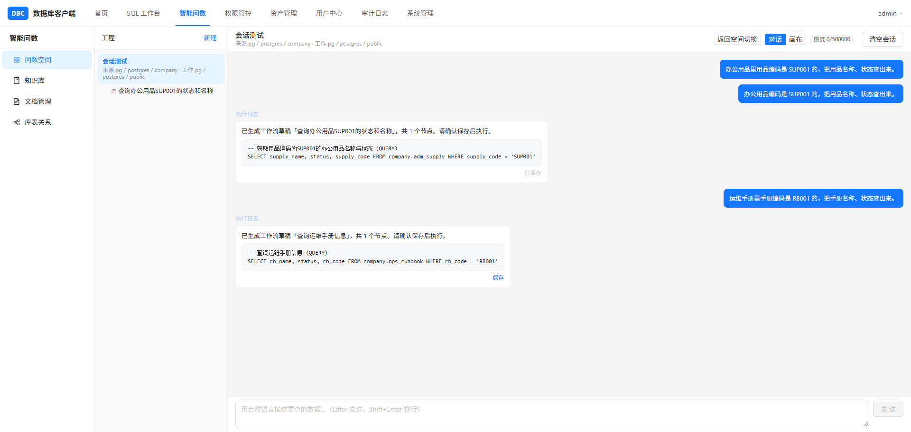

截图中的另一个问题示例是“运维手册里手册编码是 RB001 的，把手册名称、状态查出来”。这类问题依赖目标库实际存在对应表与数据；`company` 演示库的准备方法见 [演示数据说明](scripts/demo-company/README.md)。

### 9. 准备知识库与库表关系

进入 **智能问数 → 知识库**，通过“分类管理”“新建原文”维护元数据、通用知识和问题知识；列表可查看发布状态、切片数量与向量同步状态。按需编辑、切片并发布内容，供问数检索使用。

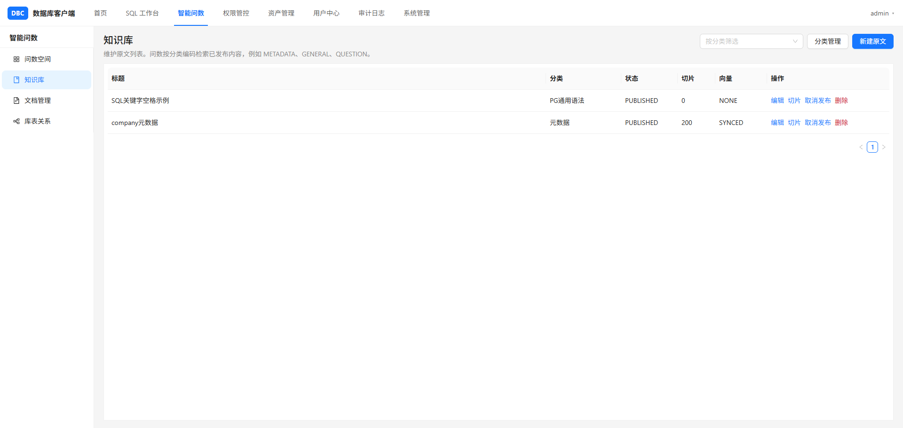

进入 **智能问数 → 库表关系**，新建图谱或通过“导入关系 MD”导入表关系，通过“画布”查看关联。图中 `default` 图谱记录 `company` 库表关系，供问数查询表关联时参考；演示关系材料见 [库表关系说明](scripts/demo-company/metadata/table-relations.md)。

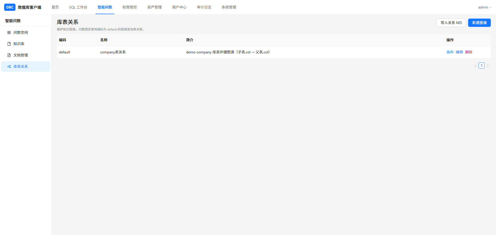

### 10. 创建测评任务

从问数空间进入 **测评空间**，新建或选择测评工程，引用模板用例或添加自定义用例。通过分类筛选查找问题，查看用例详情、必需列等要求，勾选本次用例后点击“创建任务”；通过“任务列表”查看执行情况。

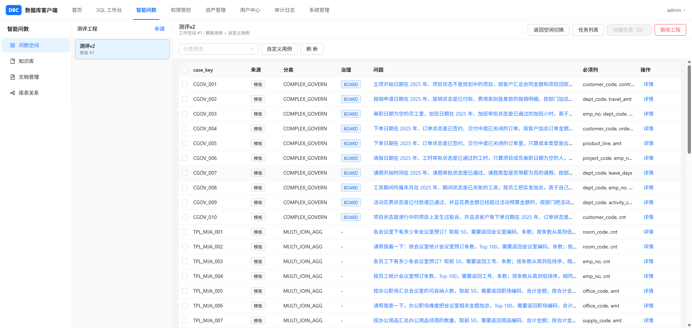

### 11. 查看测评结果与失败明细

任务列表显示状态、通过数、选表指标、问数失败数与耗时，点击“详情”进入报告。`SUCCEEDED` 表示任务已完成运行，仍需结合用例指标判断问数效果。

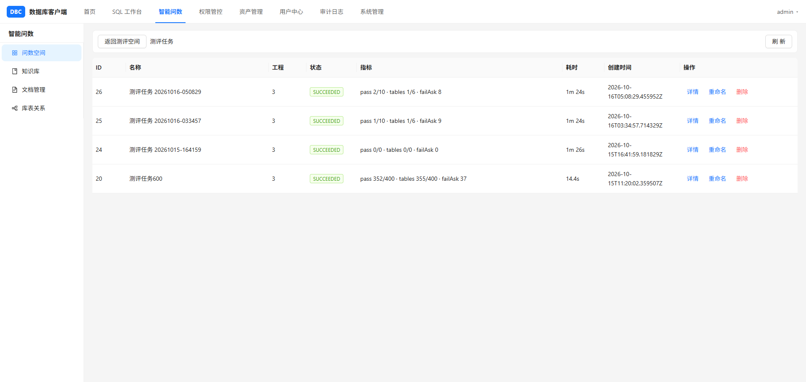

详情页展示总通过率、选表正确率、分类统计与单条用例结果，可按类型或分类筛选并查看“明细”，定位 SQL、选表或执行失败。需要重跑时，先确认选中的用例范围，再使用“重新执行”。

图中历史任务包含 400 条用例，通过 352 条，通过率为 88.0%；这些数值仅用于说明报告读法。截图中的历史分类与统计字段以当前版本页面为准。

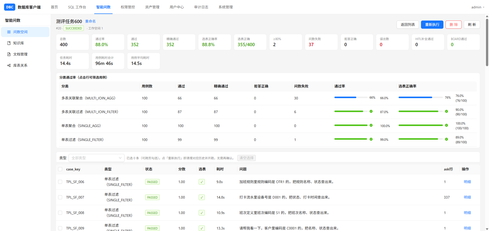

### 12. 查询审计记录

进入 **审计日志** 查询业务操作与 SQL 执行记录，用于核对操作者和执行情况。审计查询依赖 Elasticsearch；下图保留业务日志界面作为参考。

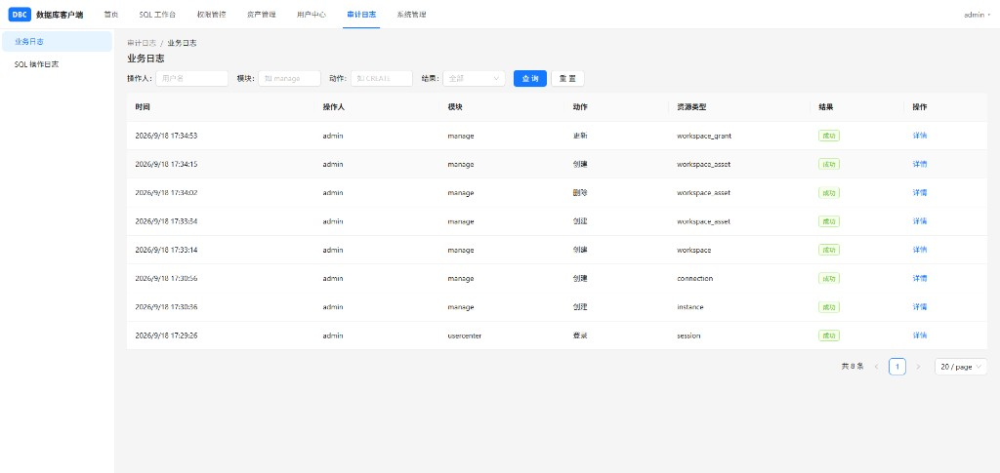

---

## 架构一览

```text
浏览器
  → Vite / Nginx
       └─ /dbc-*  → Gateway → Nacos 负载
                      ├─ usercenter   IAM / JWT / mTLS
                      ├─ manage       资产 / 空间 / 策略
                      ├─ sqlwork      目标库执行面（唯一）
                      └─ audit        审计写入与查询（ES）
```

| 模块 | 职责 |
| --- | --- |
| `dbc-front` | Vue 3 前端（唯一 SPA） |
| `dbc-gateway` | Spring Cloud Gateway 路由 |
| `dbc-usercenter` | 身份与权限、应用证书与代签 |
| `dbc-manage` | 数据资产与工作空间管控面 |
| `dbc-sqlwork` | SQL 执行与目标库连接池 |
| `dbc-audit` | 审计 ingest / 查询 |
| `dbc-client` | 跨服务 inner 客户端（mTLS / 签名） |

服务目录名、`spring.application.name`、Gateway 路径前缀三者一致（如 `/dbc-manage/**`）。

---

## 技术栈

| 层 | 选型 |
| --- | --- |
| 后端 | Java 21 · Spring Boot 3.3 · MyBatis-Plus · Gradle |
| 网关 / 发现 | Spring Cloud Gateway · Nacos |
| 平台库 | PostgreSQL（按服务分 schema，Flyway） |
| 审计存储 | Elasticsearch（仅 `dbc-audit` 写入） |
| 缓存 | Redis（服务签名 nonce 等） |
| 前端 | Vue 3 · TypeScript · Vite · Ant Design Vue · Pinia |
| 安全 | JWT · BCrypt · AES-GCM 凭证 · 服务间 mTLS + 应用层签名 |

---

## 快速开始（Docker）

适合本机联调。**非生产部署规范**（Compose 内含明文口令、关鉴权中间件等，见运维手册「已知不足」）。

**前置**：Docker Desktop、JDK 21（构建镜像时）、仓库根可写。

首次需指定**宿主机数据目录**（Postgres / Redis / ES / secrets 等），之后会写入 `deploy/dbc-docker.env`，日常启动可省略：

```powershell
cd <repo-root>

# 首次：指定本产品目录（根在 E:\app\docker\workspace）
.\scripts\docker-deploy.cmd -WorkspaceRoot E:\app\docker\workspace\dbc

# 或首次不传参，按提示输入；回车则默认 E:\app\docker\workspace\dbc

# 日常启动（复用已保存路径）
.\scripts\docker-deploy.cmd

# 改过代码后全部重建
.\scripts\docker-deploy.cmd -Build

# 只重建指定模块（短名：askdata sqlwork front gateway usercenter/uc manage audit）
.\scripts\docker-deploy.cmd -Build askdata
.\scripts\docker-deploy.cmd -Build sqlwork front

# 首次或大刷新
.\scripts\docker-deploy.cmd -Full

# 停止
.\scripts\docker-stop.cmd
```

`-Build` 模块短名（也可写 `dbc-askdata` 等全名；`usercenter` 还可写 `uc`）：`askdata` / `sqlwork` / `front` / `gateway` / `usercenter` / `manage` / `audit`。对照表见 [Docker 桌面部署手册](doc/运维/02-Docker桌面部署手册.md) §0。

也可手动复制 `deploy/dbc-docker.env.example` → `deploy/dbc-docker.env`，填写 `DBC_DOCKER_WORKSPACE=`。

浏览器打开：<http://127.0.0.1:8080>  
账号：`admin` / `admin`

中间件与应用分两个 Compose：`deploy/middleware/`、`deploy/apps/`。详情见 [Docker 桌面部署手册](doc/运维/02-Docker桌面部署手册.md)。

---

## 本地开发启动

### 依赖

- JDK 21+
- Node.js 18+
- Nacos（发现 `8000`，控制台 `8001`）
- PostgreSQL `5432`（库 `postgres`；schema 由各服务 Flyway 创建）
- Redis `6379`
- Elasticsearch `9200`（审计必依赖）

### 发布跨服务客户端（首次必做）

```powershell
cd scripts
.\publish-dbc-client.ps1
# 或：cd dbc-client ; .\gradlew.bat publishToMavenLocal
```

### 启动顺序

中间件就绪后可一键**先停再启**（默认前台汇总日志；服务名空格分隔，不写则全部）：

```powershell
.\scripts\local-start.cmd
.\scripts\local-start.cmd askdata gateway front
# 后台多窗口：
.\scripts\local-start.cmd -Background askdata gateway
```

或手动：

```powershell
# 1. 基础设施：PostgreSQL / Redis / ES / Nacos standalone

# 2～5. 业务服务（可并行）
cd dbc-usercenter ; .\gradlew.bat bootRun   # :8004
cd dbc-manage     ; .\gradlew.bat bootRun   # :8006
cd dbc-sqlwork    ; .\gradlew.bat bootRun   # :8007
cd dbc-audit      ; .\gradlew.bat bootRun   # :8008

# 6. 网关
cd dbc-gateway    ; .\gradlew.bat bootRun   # :8003

# 7. 前端
cd dbc-front
npm.cmd install
npm.cmd run dev                             # :8005
```

开发入口：<http://127.0.0.1:8005>（Vite 将 `/dbc-*` 代理到 Gateway）。

密钥与 mTLS 材料位于仓库根 `secrets/`（已 gitignore，启动用户中心时会按需生成）。工作目录须为**仓库根**。完整说明见 [本地启动说明](doc/运维/01-本地启动说明.md)。

### 端口约定

| 服务 | 端口 |
| --- | --- |
| Nacos / 控制台 | 8000 / 8001 |
| gateway | 8003 |
| usercenter | 8004（mTLS 8044） |
| front (dev) | 8005 |
| manage | 8006 |
| sqlwork | 8007 |
| audit | 8008（mTLS ingest 8048） |

---

## 仓库结构

```text
database-client/
├── dbc-front/          # 前端
├── dbc-gateway/        # 网关
├── dbc-usercenter/     # 用户中心
├── dbc-manage/         # 资产管理 / 权限管控
├── dbc-sqlwork/        # SQL 工作台
├── dbc-audit/          # 审计
├── dbc-client/         # 跨服务客户端库
├── deploy/             # Docker Compose
├── scripts/            # 部署与发布脚本
├── drivers/            # JDBC 驱动（按需）
├── secrets/            # 本地密钥（不入库）
├── docs/images/        # README 界面截图
└── doc/                # 设计 / 规范 / 运维文档
```

各业务服务为**独立 Gradle 工程**（非单一 root 多模块）。IDEA 需分别 Link 各工程的 `build.gradle.kts`。

---

## 文档

| 文档 | 内容 |
| --- | --- |
| [doc/README.md](doc/README.md) | 文档总索引 |
| [需求设计](doc/设计/需求/01-需求设计.md) | 业务规格与功能清单 |
| [架构设计](doc/设计/架构/01-架构设计.md) | 技术架构与选型 |
| [详细设计](doc/设计/详细设计/) | 各模块与横向能力 |
| [编码规范](doc/规范/01-Java编码规范.md) | Java / 模块约定 |
| [运维](doc/运维/) | 本地启动与 Docker |

---

## 安全说明

- **勿将** `secrets/`、证书、JWT 密钥、数据库口令提交到 Git。
- 开源前请确认仓库中无真实生产凭证；示例 Compose 中的口令仅供本地联调。
- 服务间调用：用户 JWT 走公网 API；`/inner/**` 走 mTLS / 应用层签名，详见 [服务间请求签名](doc/设计/详细设计/04-服务间请求签名.md)。
- 生产环境需自行补齐：密钥托管（KMS）、中间件鉴权、多实例与备份、资源限额等（见运维手册「已知不足」）。

---

## 贡献

欢迎 Issue 与 Pull Request。较大改动建议先开 Issue 对齐设计口径（与 [doc/](doc/) 保持一致）。提交前请确保：

- 本地可编译 / 关键用例通过
- 异常日志带完整栈（见仓库规范）
- 不引入明文密钥或 demo 级捷径而不标注

---

## License

[Apache License 2.0](LICENSE)
