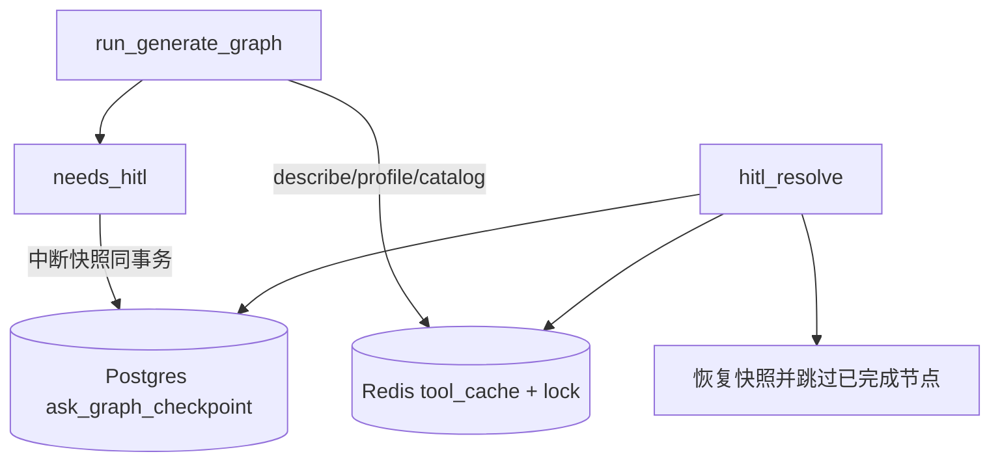
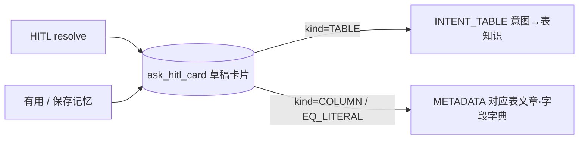

# 问数开放能力落地计划（定稿）

> 状态：**实现中 / 首批已落地**  
> 依据：`doc/todo.md` + 会话拍板

---

## 0. 拍板摘要

| 项 | 定稿 |
|---|---|
| 权限/多租户/SQL安全/脱敏 | 归 **sqlwork**，askdata 不做 |
| API 配额 | 按**登录用户**、**上海自然日**累计 LLM token；超 `DBC_ASKDATA_DAILY_TOKEN_LIMIT` → **429**；**测评（eval）不计额度、不拦截、前端不展示额度** |
| 分布式锁 | 共用平台 **Redis**；askdata 用异步 Redis `SET NX EX`（等同 Redisson 锁语义） |
| Prompt/模型/工具版本 | **配置文件启动加载**（非 DB 版本表） |
| HITL 断点续跑 | **企业级两层存储**（见 §1） |
| Review 失败 | 转 **HITL**，禁止放行 |
| P1 性能 | 断点+工具缓存 **且** gather 并行、小模型、verify 画像合并预取 |

---

## 1. HITL 断点续跑（企业级）

### 1.1 现状

- 图状态仅进程内存；HITL 只落 `AskHitl.question` + 极简 `options`。
- resolve 后 `run_generate_graph` **整图重跑**，无 checkpointer。

### 1.2 企业级两层存储（定稿）

| 层 | 内容 | 介质 | TTL/生命周期 |
|---|---|---|---|
| **中断快照** | `thread_id`(=session)、`hitl_id`、`interrupted_node`、`route`、`question`、`catalog`、`table_intent`、`db_general_knowledge`、`draft`、`verify_*`/`review_*` 轮次与 critique、已完成节点集合 | **PostgreSQL** 表 `ask_graph_checkpoint`（JSONB + 索引）；与 `AskHitl` 同事务写入 | HITL RESOLVED 后保留可配置天数；可审计排障 |
| **工具结果缓存** | `describe_table` / `get_column_profile` / catalog 命中摘要 | **Redis**，key=`ask:tool:{conn}:{db}:{schema}:{name}` | TTL 默认 1h；续跑优先读缓存 |

**不采用**：仅依赖 LangGraph 内置 checkpointer 黑盒（本期）；用应用级快照，语义清晰、可审计、与现有 `AskHitl` 对齐。

### 1.3 续跑流程

1. HITL：写 `AskHitl(PENDING)` + `ask_graph_checkpoint`（status=INTERRUPTED）。  
2. resolve：Redis 锁 `ask:lock:hitl:{hitl_id}` → 校验 PENDING → 落 resolution → 加载 checkpoint → 合并 `hitl_resolution` → 从 `resume_node` 继续（跳过已完成的 intent_gate/gather，若 catalog 指纹仍有效）。  
3. 工具网关：命中 Redis 缓存则不调 sqlwork。  
4. 成功 present：checkpoint → COMPLETED；失败可保留 INTERRUPTED 供重试。

### 1.4 验收

- 续跑不重复 describe/profile（缓存命中可观测）。  
- 同一 HITL 不产生第二条 PENDING。  
- 进程重启后仍可凭 PG 快照 + resolve 续跑。

---

## 2. 其余 P0

### 2.1 用户日 token 限额

- 表或 Redis 计数：`user_id + usage_date(Asia/Shanghai)`。  
- Span/LLM 返回后累加 `token_in+token_out`（加锁）。  
- 依赖挂在 `/api/chat`、`/api/hitl/resolve`；超限 429。  
- `limit=0` 关闭。  
- **测评例外（定稿）**：
  - `eval_mode` / 测评任务执行路径：**不检查、不累加**日额度；
  - 测评相关 API 与前端测评页：**不返回、不展示**用户今日额度；
  - 仅工作台等真人问数路径展示额度（若做额度展示接口，测评 UI 不调用）。

### 2.2 幂等

- 头 `Idempotency-Key`；表 `ask_idempotency`。  
- 写路径 Redis 锁；同 key 返回首次响应。

### 2.3 Review → HITL

- 改 `parse_review_verdict`：空/解析失败/未知 action → `action=hitl`。

---

## 3. P1

| 项 | 定稿 |
|---|---|
| 记忆 | 统一拉 10；CHAT 近窗原文；QUERY/GOVERN `{question,tables}` |
| 知识库 | 重试 1 次，失败 → HITL |
| 图谱 | 重试失败忽略 + 带栈业务日志 |
| Agent / LLM 包 | `llm/providers/<provider>/`（`DBC_ASKDATA_LLM_PROVIDER`）加载模型档位+Adapter+提示词；旧 `agent_bundle` 仅作显式 overlay |
| HITL UI | `options.ui`：kind/fields/candidates；前端分槽；映射进 `hitl_confirmation` |
| gather 并行 | 无依赖步骤 `asyncio.gather` |
| verify 画像 | 多列 key 合并后并行预取再比对 |
| HITL→知识 | 见 **§3.1**（确认卡片 + 有用归并） |

### 3.1 HITL 确认卡片 → 有用归并知识（定稿）

> 拍板：每次 HITL（选表 / 字段 / 状态码值等）先落**确认卡片**；用户对成功运行点「有用/保存记忆」后再晋级写入知识库。  
> 不在 resolve 当时直接污染正式召回。

| 阶段 | 行为 |
|---|---|
| **resolve** | 按 `ui.kind` + resolution 结构化写入 `ask_hitl_card`（status=`PENDING`）；本轮续跑仍只靠 `hitl_confirmation` |
| **有用/记忆** | 取出本会话未晋级卡片；与最终草稿涉表对齐后归并；成功标 `PROMOTED`，冲突标 `CONFLICT` |
| **TABLE** | 追加到作用域下 **INTENT_TABLE** 知识文（无则创建草稿并绑定）；键=`normalize(surface)`→物理表；同表计数加强，异表冲突不覆盖 |
| **COLUMN / EQ_LITERAL** | 精确定位作用域 **METADATA** 绑定文，在对应表章节下合并 `### 人工确认·字段字典`；键=`table+column+surface`；同码合并，异码冲突 |
| **SCOPE / REVIEW 等** | 本期只留卡片，不自动归并（避免散文污染） |
| **发布** | 与问句知识一致：写入 **草稿** + `suggest_slices`；需审批发布后才进正式召回 |

合并原则：结构化段落模板、同键合并、冲突不静默覆盖；METADATA 已发布则 `start-update` 出替换草稿再改正文。

与现有「有用→QUESTION 问句样本」**并存**：问句样本管「整问→涉表」；INTENT_TABLE 管「短意图→表」；表文字典管「列/码值」。

---

## 4. 实施顺序

1. Review → HITL  
2. Redis 客户端 + 分布式锁  
3. 用户日 token 配额  
4. 幂等  
5. **企业级断点**：PG checkpoint 表 + Redis 工具缓存 + 续跑跳过  
6. 知识重试 / 图谱降级  
7. 记忆统一  
8. HITL UI 契约  
9. agent_bundle 配置 + 小模型  
10. gather 并行 + verify 画像合并  
11. **HITL 确认卡片 + 有用归并**（§3.1）  

---

## 5. 关键路径

- API：`dbc-askdata/src/dbc_askdata/api/routes.py`  
- 图：`.../graph/generate.py`、`sql_review.py`、`hitl_prompt.py`  
- 工具：`.../tools/gateway.py`  
- HITL 卡片 / 归并：`.../knowledge/hitl_card.py`、`hitl_promote.py`；表 `ask_hitl_card`  
- 反馈晋级：`.../feedback/service.py`（useful/memory）  
- 新：`quota/`、`redis/`（锁+缓存）、`checkpoint/`、`migrations/V*__*.sql`  
- 配置：`config.py` + `agent_bundle.yaml`  
- 前端：`AskdataWorkbenchView.vue`  
